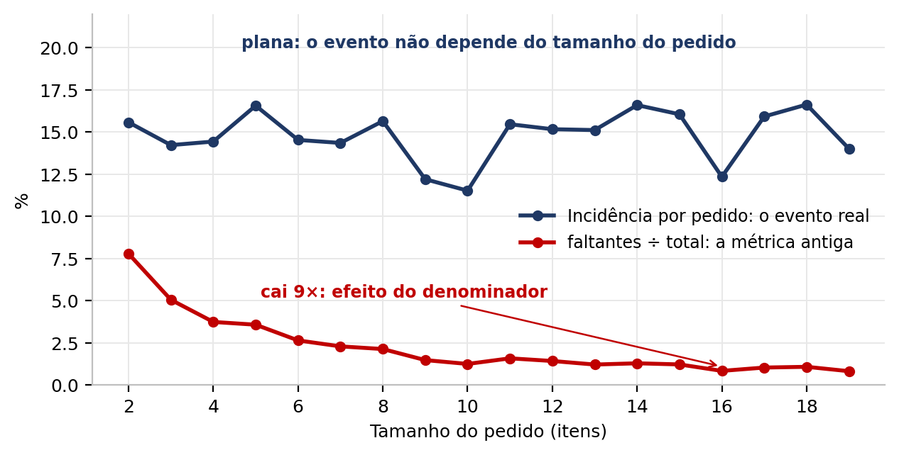
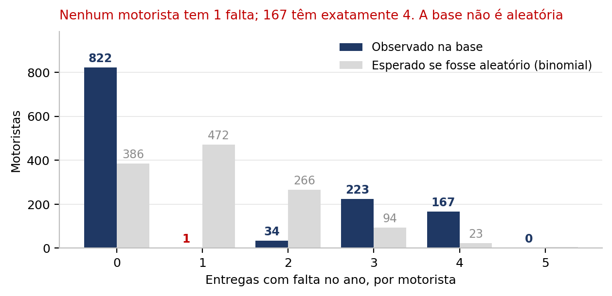
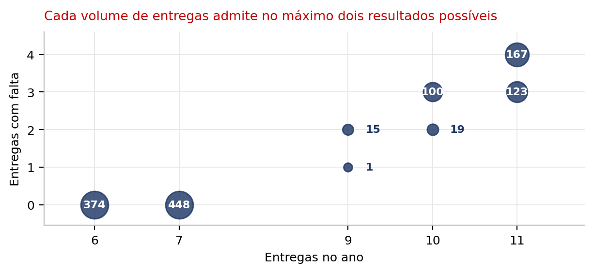
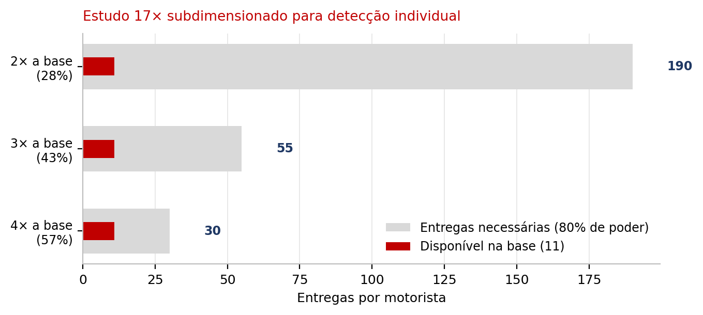

# Detecção de fraude em entregas de última milha

Análise de 10.000 pedidos de e-commerce para responder a uma pergunta de
operações: **os itens registrados como "não entregues" indicam fraude de motorista?**

A resposta é não, e o caminho até ela é o conteúdo deste repositório.

> ### ⚠️ Sobre a base
> Este é um **dataset sintético**, usado como exercício de análise. Não são dados
> operacionais de nenhuma empresa real, e nenhuma conclusão aqui descreve uma
> operação existente.
>
> Identificar que a base é gerada, e não observada, foi um dos dois resultados
> da análise. A prova está em [Achado 2](#achado-2--a-base-é-gerada-não-observada).

O repositório separa o que entrou do que saiu: **`dados_brutos/`** guarda a base original,
que o pipeline apenas lê, e **`resultados/`** guarda tudo que a análise produziu. O código que
leva de um ao outro está em `src/`.

---

## Resultados

| | |
|---|---|
| Incidência de pedidos com ao menos um item faltante | **14,20%** (IC 95%: 13,52% a 14,90%) |
| Taxa agregada de itens faltantes | **1,55%** (IC 95%: 1,48% a 1,63%) |
| Valor associado aos itens faltantes | **US$ 72.870** (2,61% do faturamento) |
| Motoristas testados | 1.247 |
| Motoristas com desvio estatisticamente significativo | **0** |

O benchmark de indústria de 1,5% usado como referência cai **dentro**
do intervalo de confiança da taxa observada. A diferença de 0,05 p.p.
não é distinguível de ruído amostral, então a operação não é descrita nem como acima
nem como abaixo do benchmark.

---

## Achado 1: o KPI original media tamanho de pedido

A métrica natural para "itens faltantes" é `itens_faltantes ÷ itens_totais`. Ela está errada
para esta operação, e o motivo é estrutural: **a falta é um evento que ocorre no pedido, não
em cada item**.

A probabilidade de um pedido apresentar falta é estatisticamente constante ao longo de todo
o intervalo de tamanhos (Spearman ρ = 0,166, p = 0,510, sem tendência).
Já a razão cai 9,4× no mesmo intervalo (ρ = -0,967), inteiramente por
efeito do denominador.



**Consequência prática:** qualquer ranking de motoristas construído sobre essa razão ordena
os motoristas por mix de tamanho de pedido, não por conduta. Quem atende pedidos pequenos
aparece no topo sem qualquer desvio de comportamento.

O KPI foi redefinido como **incidência por pedido**, a proporção de pedidos com ao menos um
item faltante. A taxa agregada (`Σ faltantes ÷ Σ itens`) fica como métrica secundária de volume.

A média simples das razões por pedido, que trata um pedido de 2 itens igual a um de 19,
infla o resultado em 1,40× (2,18% contra 1,55%). Não é uma taxa
operacional e não foi usada.

---

## Achado 2: a base é gerada, não observada

Testar 1.247 motoristas a 5% de significância produziria cerca de 62 "descobertas"
por puro acaso. Por isso o critério de decisão é o q-valor após correção de
Benjamini-Hochberg, não o p-valor bruto.

**Nenhum motorista atinge sequer o limiar bruto de 0,05**. O menor p-valor da base é
0,0585, e o menor q-valor, 0,437.

Antes de ler isso como "operação limpa", vale verificar se a base sequer admite variação
individual. Ela não admite. Se as faltas fossem sorteadas de forma independente, a
distribuição por motorista seria binomial. O observado diverge dela de forma extrema
(qui-quadrado = 2.228):



Sob um processo aleatório, 472,4 motoristas teriam exatamente uma entrega com falta.
A base tem **1**.

A causa fica evidente ao cruzar volume com ocorrências: o número de entregas com falta é
praticamente uma função determinística do número de entregas:



Motoristas com 6 ou 7 entregas têm sempre zero faltas. 2 dos 5 volumes distintos
admitem um único resultado possível; os demais admitem dois.

**A "taxa" de cada motorista nesta base é determinada pelo seu volume, não pela conduta.**
Qualquer lista de suspeitos extraída daqui seria, necessariamente, uma lista dos motoristas
mais ativos.

---

## Poder estatístico

Mesmo que houvesse sinal, o estudo não teria poder para detectá-lo. Com alfa corrigido para
1.247 testes e poder alvo de 80%:

| Cenário | Entregas necessárias | Disponível na base |
|---|---|---|
| Motorista operando a 2× a incidência base (28,4%) | 190 | 11 |
| Motorista operando a 3× a incidência base (42,6%) | 55 | 11 |
| Motorista operando a 4× a incidência base (56,8%) | 30 | 11 |



O motorista mais ativo da base tem 11 entregas no ano; a mediana da frota é
7. O estudo está **17× subdimensionado** para detecção individual.

A ausência de significância não prova ausência de fraude. Prova que esta base não tem volume
por motorista para detectá-la.

---

## O que a base não permite concluir

A base tem 9 colunas: `driver_name`, `driver_id`, `region`, `date`, `delivery_hour_num`, `items_delivered`, `items_missing`, `items_total`, `order_amount_clean`. Não há identificador de produto,
categoria, cliente ou registro de reclamação. Estão fora do escopo possível deste dado:
análise de mix de produto, ranking de SKUs, segmentação de clientes e qualquer comparação
com período anterior.

Três cortes foram testados com qui-quadrado de aderência. Nenhum apresenta variação
distinguível de flutuação aleatória:

| Dimensão | χ² | g.l. | p-valor | Amplitude |
|---|---|---|---|---|
| Região | 2,92 | 6 | 0,819 | 1,97 p.p. |
| Hora da entrega | 23,39 | 23 | 0,438 | 6,23 p.p. |
| Mês | 7,89 | 11 | 0,723 | 3,09 p.p. |

---

## Tratamento aplicado à base

A coluna `items_delivered` está truncada em 19 na base original, o que força falta em
todo pedido acima desse teto: 96 pedidos, 100% deles com falta, somando
114 itens (6,9% das faltas brutas). Foram removidos por serem artefato de
geração, não ocorrência operacional. Base analítica final: 9.904 pedidos.

Outros indícios de geração sintética, registrados para transparência:

- Nenhum dos 419 pedidos de item único apresenta falta (esperado: cerca de 59).
- Entregas por motorista assumem apenas os valores 6, 7, 10, 11.
- Nenhum pedido registra mais de 3 itens faltantes.

Integridade verificada: zero valores nulos e a identidade
`itens_entregues + itens_faltantes = itens_total` válida em 100% das linhas.

---

## Reprodutibilidade

**Nenhum número dos entregáveis é digitado à mão.** `pipeline.py` lê a base e escreve
`output/metricas.json`; relatório, planilha, gráficos e slides são gerados a partir desse
JSON. `verificar.py` varre todo número citado nos entregáveis e falha se algum não for
derivável do JSON. É a defesa contra o número órfão, que é o modo mais comum de um deck
divergir da análise que o originou.

```bash
pip install -r requirements.txt
npm install docx

python src/pipeline.py          # base -> output/metricas.json + tabelas
python src/gerar_graficos.py    # gráficos do relatório
python src/gerar_excel.py       # workbook analítico + CSV
node   src/gerar_relatorio.js   # relatório .docx
python src/gerar_readme.py      # este arquivo
python src/verificar.py         # consistência cruzada (sai != 0 se falhar)
```

### Estrutura

```
├── data/entregas_2023.xlsx     base original
├── src/
│   ├── pipeline.py             fonte de verdade. Toda métrica sai daqui
│   ├── gerar_excel.py          workbook analítico (KPIs em fórmulas vivas)
│   ├── gerar_relatorio.js      relatório .docx
│   ├── gerar_graficos.py       figuras do relatório
│   ├── gerar_graficos_slide.py figuras do deck
│   ├── gerar_deck.py           slides
│   ├── gerar_readme.py         este README
│   └── verificar.py            consistência cruzada entre entregáveis
├── docs/                       entregáveis prontos para leitura
└── output/                     gerado (não versionado)
```

### Decisões metodológicas

1. **KPI primário = incidência por pedido.** A falta é evento por pedido, não por item (Achado 1).
2. **Média de razões é proibida.** Dá o mesmo peso a pedidos de tamanhos diferentes e infla o resultado.
3. **Teste binomial exato unilateral** por motorista, sobre pedidos, contra a incidência base.
4. **Correção Benjamini-Hochberg** obrigatória: com 1.247 testes, p-valor bruto não decide nada.
5. **Poder calculado antes de concluir.** Um resultado negativo sem análise de poder não é resultado.
6. **Artefatos de geração removidos e documentados**, nunca silenciosamente.

---

## Entregáveis

| Arquivo | Conteúdo |
|---|---|
| [`resultados/Relatorio_Fraude_Entregas_Last_Mile_2023.pdf`](resultados/Relatorio_Fraude_Entregas_Last_Mile_2023.pdf) | Relatório completo, 7 páginas |
| [`resultados/Analise_Fraude_Entregas_Last_Mile_2023.xlsx`](resultados/Analise_Fraude_Entregas_Last_Mile_2023.xlsx) | Workbook com 10 abas; `Overview` calcula os KPIs em fórmulas vivas sobre a base |
| [`resultados/drivers_ranking_acompanhamento.csv`](resultados/drivers_ranking_acompanhamento.csv) | Ranking de acompanhamento operacional, com p-valor e q-valor |

O CSV de motoristas é um ranking de **priorização de auditoria amostral**, não uma lista de
suspeitos: nenhum dos motoristas nele atinge significância estatística, e a coluna
`significativo_apos_correcao` registra isso explicitamente.

---

## Stack

Python (pandas, scipy, statsmodels, openpyxl, matplotlib) · Node (docx) · Excel com fórmulas vivas
